<div align="center">

# 🎨 Art Supply Website

**A full-featured online art supply shop built with Django.**
Browse a catalogue, fill a cart, check out, pay, and follow every order on a
tracking timeline, all managed from the Django admin.

[](https://github.com/sobhan-imani/art-supply-website/actions/workflows/ci.yml)
[](https://www.python.org/)
[](https://www.djangoproject.com/)
[](https://www.django-rest-framework.org/)
[](https://www.postgresql.org/)
[](https://getbootstrap.com/)
[](https://docs.astral.sh/ruff/)
[](LICENSE)

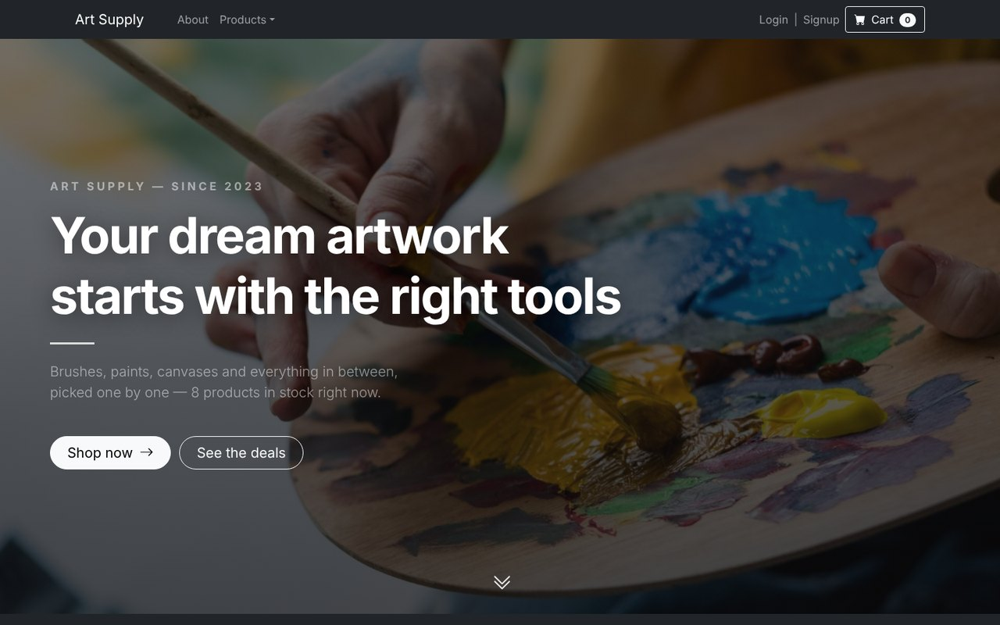

[Screenshots](#-screenshots) •
[Features](#-features) •
[Quick start](#-quick-start) •
[How it works](#-how-it-works) •
[Deploying](#-deploying) •
[Tests](#-tests)

</div>

---

## 📸 Screenshots

<table>
  <tr>
    <td width="50%">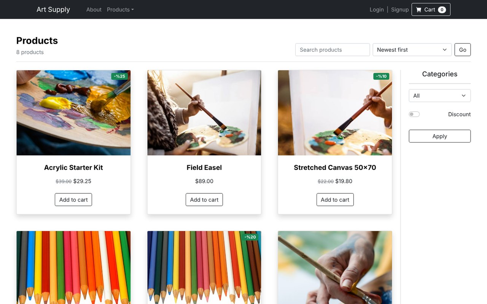<br><sub><b>Catalogue</b>: categories, search, sort and a discount filter, all kept in the URL.</sub></td>
    <td width="50%">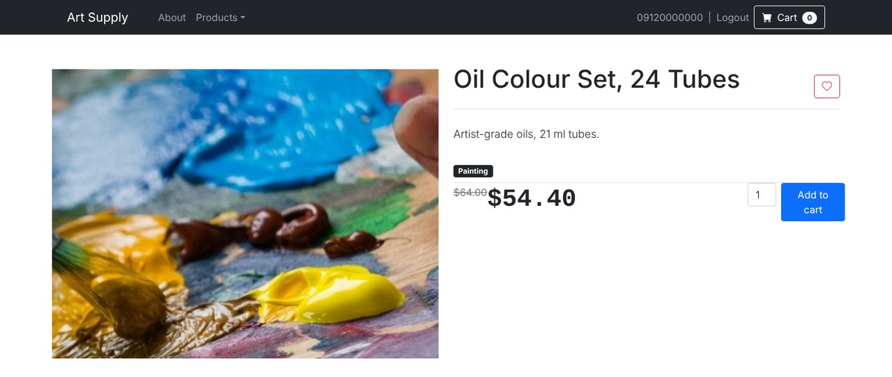<br><sub><b>Product page</b>: wishlist toggle, category badge, add to cart with a quantity.</sub></td>
  </tr>
  <tr>
    <td>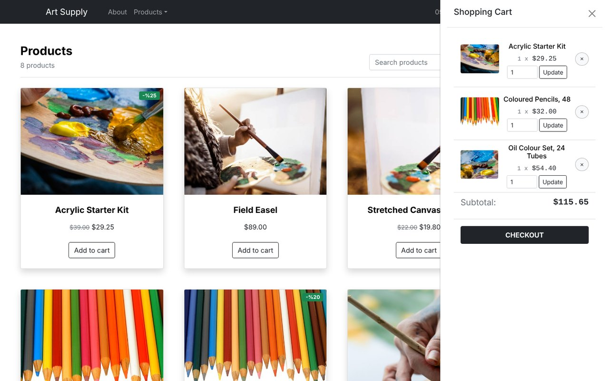<br><sub><b>Cart</b>: a sidebar on every page that updates in place without a reload.</sub></td>
    <td>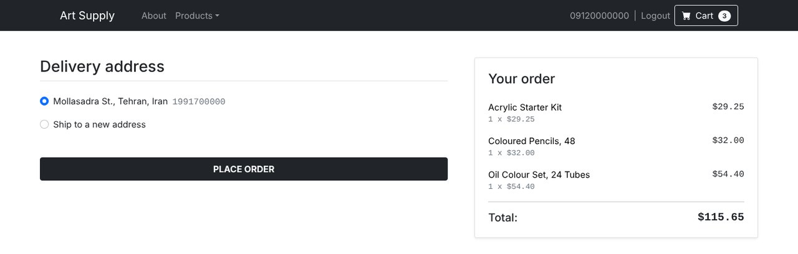<br><sub><b>Checkout</b>: pick a saved address or add a new one. Stock is reserved atomically.</sub></td>
  </tr>
  <tr>
    <td>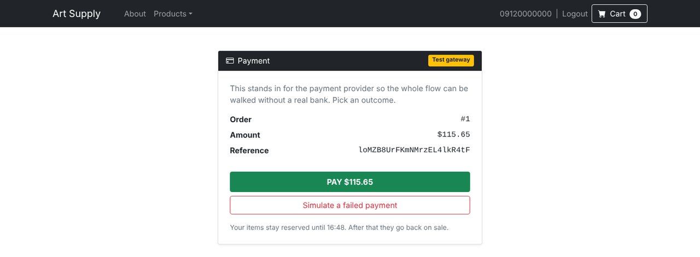<br><sub><b>Payment</b>: the built-in test gateway walks the whole flow without a bank.</sub></td>
    <td>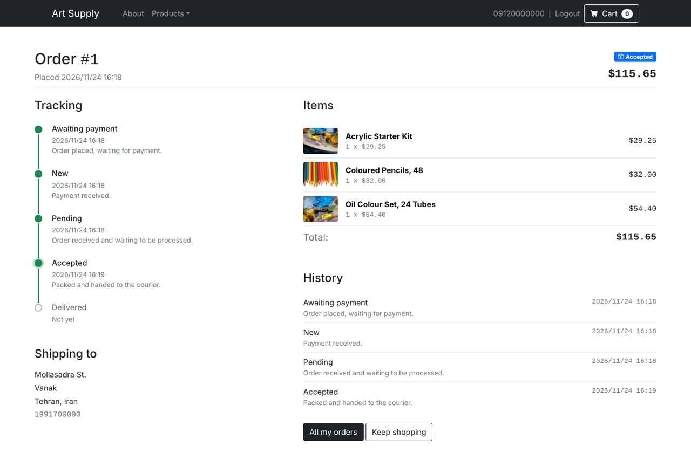<br><sub><b>Order tracking</b>: a timeline built from every status change.</sub></td>
  </tr>
  <tr>
    <td>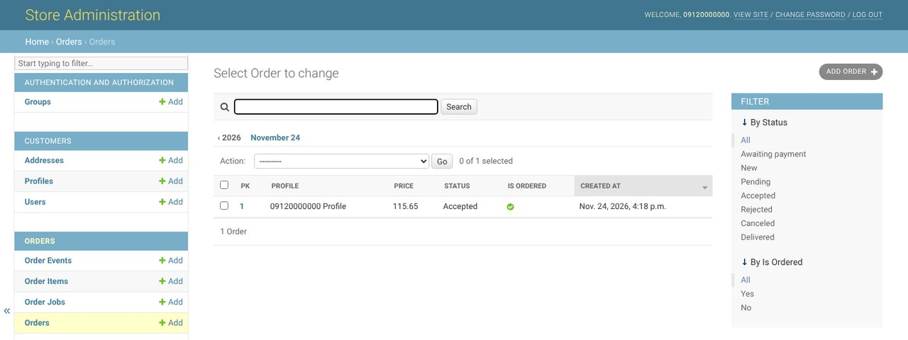<br><sub><b>Store administration</b>: catalogue, stock, orders, payments and the job queue.</sub></td>
    <td align="center">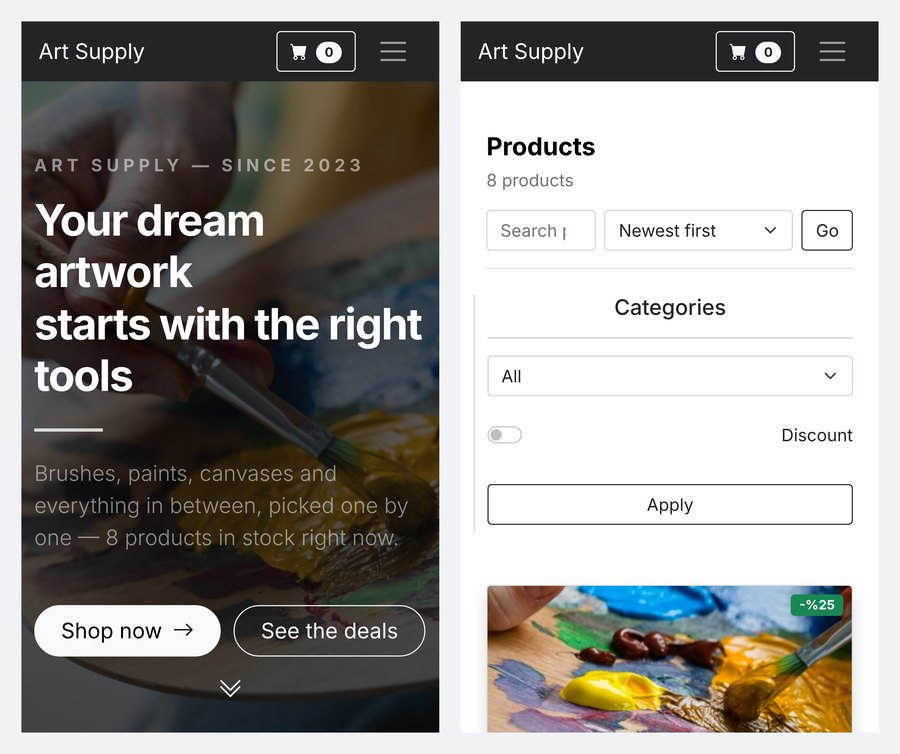<br><sub><b>Responsive</b>: the same store on a phone.</sub></td>
  </tr>
</table>

> The screenshots were taken from a local install with demo products.

---

## ✨ Features

| | |
|---|---|
| 🛍️ **Catalogue & filtering** | Nested categories, search, sort and a discount filter, all reflected in shareable URLs. |
| 🛒 **Cart** | A session-backed sidebar on every page. Every button works without JavaScript, then gets a `fetch()` upgrade for a smoother feel. |
| 💳 **Checkout & payment** | Stock is reserved atomically at checkout. A `Gateway` abstraction hands the customer to a payment provider (a dummy gateway out of the box), and an idempotent callback confirms the order. |
| 📦 **Order tracking** | A timeline of status events per order. Orders that are never paid are cancelled and their stock is released. |
| 👤 **Accounts** | Signup and login by phone number, an address book, a wishlist and order history. |
| ⚙️ **Background jobs** | A database-backed job queue for slow or flaky work (mail, confirmations), with retries and its own worker command. |
| 🧑‍💼 **Store administration** | The Django admin manages the catalogue, tracks inventory, and moves orders through their statuses. |
| 🔌 **JWT API** | Token auth, a wishlist toggle and a profile endpoint, ready for a mobile or JS client. |
| ✅ **Quality gates** | 129 tests, `ruff`, a missing-migration check and `check --deploy` run in GitHub Actions on every push. |

---

## 🧰 Tech stack

| Layer | Tools |
|---|---|
| **Backend** | Python 3.11, Django 4.1, Django REST Framework, Simple JWT |
| **Database** | SQLite for development, PostgreSQL for production |
| **Frontend** | Django templates, Bootstrap 5, vanilla JS (progressive enhancement, no build step) |
| **Background work** | A database-backed queue, `SELECT … FOR UPDATE SKIP LOCKED` |
| **Serving** | Gunicorn, WhiteNoise, a `Procfile` for PaaS hosts |
| **Quality** | Django's test runner, `ruff`, GitHub Actions |

---

## 🚀 Quick start

**Prerequisites:** Python 3.11+ and Git.

```bash
git clone https://github.com/sobhan-imani/art-supply-website.git
```

```bash
cd art-supply-website
python -m venv .venv && source .venv/bin/activate   # Windows: .venv\Scripts\activate
pip install -r requirements.txt
```

```bash
cd store
python manage.py migrate
python manage.py createsuperuser   # optional, for /admin/
python manage.py runserver
```

| URL | What's there |
|---|---|
| http://127.0.0.1:8000/ | The store |
| http://127.0.0.1:8000/admin/ | Store administration |
| http://127.0.0.1:8000/api/token/ | JWT API (also `token/refresh/`, `profile/`, `wishlist/<id>/`) |

That is all development needs. SQLite, e-mail printed to the console and
`DEBUG=1` are the defaults, so no `.env` file is required to get started (see
[Configuration](#configuration) for production). Add a few categories and
items in the admin to fill the shop.

---

## 🗂️ Project structure

```text
art-supply-website/
├── requirements.txt / requirements-dev.txt
├── Procfile                  # web, worker and release processes
├── .env.example
├── docs/screenshots/         # the images in this README
└── store/                    # the Django project root (manage.py lives here)
    ├── config/               # settings, root urls, wsgi/asgi
    ├── core/                 # BaseModel + soft delete, shared admin, template tags
    ├── products/             # Category, Item, catalogue views and filters
    ├── customers/            # the phone-number user, Profile, Address, auth
    ├── orders/               # cart, checkout, payment, tracking, job queue
    ├── api/                  # JWT tokens, wishlist toggle, profile endpoint
    ├── static/
    │   ├── css/ js/ img/     # the project's own assets
    │   └── vendor/           # third-party code (Bootstrap)
    ├── templates/
    └── locale/fa/            # Persian translations
```

### Data model

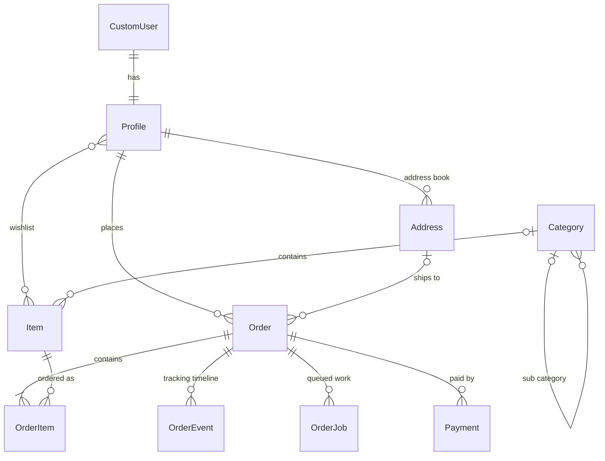

---

## 🔍 How it works

### The cart

The cart is the sidebar in the navbar, on every page; there is no separate
cart page. The session only holds `{item_id: quantity}` (`orders/cart.py`).
Everything else is read from the database, so a price or a discount can never
go stale. `orders.context_processor.cart` puts it in every template, and
`templates/orders/_cart_sidebar.html` is the one piece of cart markup: the
page includes it, and the cart views re-render the same file for their JSON
answers. Every cart button is a plain form that works without JavaScript;
`static/js/cart.js` upgrades them to `fetch` and swaps the sidebar in place.

### Checkout, payment and the order queue

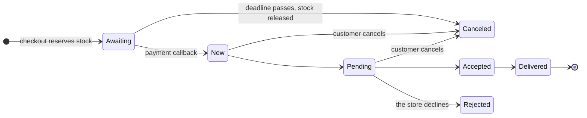

Checkout does only what cannot wait: inside one transaction it reserves the
stock (locking the item rows and using conditional updates, so the last piece
can never be sold twice) and writes the order as **awaiting payment**. A
duplicate submission is recognised by a one-shot token, so a double click or a
refreshed POST cannot produce a second order.

From there the customer goes to the gateway. The shop only ever talks to a
`Gateway` object (`orders/payment.py`), so connecting a real provider means
writing one class and pointing `PAYMENT_GATEWAY` at it, with no view,
template or test changes. Out of the box it uses `DummyGateway`, which walks
the whole road (token, provider page, callback) without touching a bank. The
callback is idempotent: a retry or a refresh never charges the stock twice or
sends the confirmation again.

Once a payment lands, the slow work is queued rather than done in the
request, so a mail server that hangs cannot break a checkout:

```bash
python manage.py process_order_jobs            # one pass, for cron
python manage.py process_order_jobs --loop     # a long running worker
```

Jobs are claimed with `SELECT ... FOR UPDATE SKIP LOCKED`, so several workers
can share the queue, and they retry with a growing delay before giving up
after `max_attempts`. Nothing is lost if a worker is restarted mid deploy: the
row simply stays queued. Failed jobs are visible in the admin and can be
requeued from there. Handlers live in `orders/queue.py`; to move to Celery
later, a task only has to call `run_job`. On SQLite the locking clauses are
ignored, which is fine for development because there is a single writer
anyway.

The queue also holds the deadline: an order that is never paid has its
`expire_unpaid_order` job run after `PAYMENT_DEADLINE_MINUTES`, which cancels
it and puts the reserved items back on sale. It needs no cron job of its own.

Order state lives in `Order.status` and every change is written to
`OrderEvent`, which is what the tracking page draws as a timeline. Moving an
order along in the admin records an event too. `orders/services.py` holds the
three operations the views, the queue and the payment callback share:
`place_order`, `mark_order_paid` and `cancel_order`.

### Deleting is withdrawing

Everything inheriting `BaseModel` is soft deleted: `delete()` sets
`is_deleted` and `objects` hides those rows, so a withdrawn product
disappears from the shop while the orders that contain it keep working. Two
things follow from this:

- use `all_objects` when you need the withdrawn rows too (the admin does), and
  `delete(hard=True)` when a row really has to go;
- foreign keys still resolve withdrawn rows, which is why an old order can
  show the product and the address it shipped to even after both were
  removed.

### Product images

`products/images.py` is the one place that decides what an item shows: its
own picture when the file really exists on disk, otherwise
`static/img/product-placeholder.jpg` (public domain, a stack of colored
pencils). Templates use it through the `product_image` filter
(`{{ item|product_image }}`), and the API serializer calls the same helper, so
a product's JSON and its page never disagree about the picture.

---

## ⚙️ Configuration

Everything machine specific comes from the environment. `store/config/env.py`
reads a `.env` file (see [`.env.example`](.env.example)) for convenience, and
real environment variables always win over it.

Production needs at least `DJANGO_DEBUG=0`, `DJANGO_SECRET_KEY`,
`DJANGO_ALLOWED_HOSTS` and the `DATABASE_*` variables. Without a secret key
the project refuses to start rather than run on the development one.

---

## 🌐 Deploying

```bash
pip install -r requirements.txt
python store/manage.py migrate --noinput
python store/manage.py collectstatic --noinput
gunicorn config.wsgi --chdir store --bind 0.0.0.0:8000
python store/manage.py process_order_jobs --loop   # a second process
```

The `Procfile` runs the same three processes on a PaaS. Two things the app
does not do for you once `DEBUG=0`:

- **Uploaded files.** Django stops serving `MEDIA_ROOT`, on purpose. Point the
  web server at it, e.g. `location /media/ { alias /var/www/artsupply/media/; }`.
- **Static files.** `collectstatic` fills `STATIC_ROOT`. WhiteNoise serves it
  from the app if it is installed (it is in `requirements.txt`); otherwise
  serve `STATIC_ROOT` from the web server as well.

Migrations are committed to the repository on purpose: a deploy that
generates them on the server builds a schema nobody reviewed. CI fails if a
model change has no migration.

---

## 🧪 Tests

129 tests, and the same four gates CI runs on every push:

```bash
cd store
python -m ruff check .                              # style and likely mistakes
python manage.py makemigrations --check --dry-run   # a model change with no migration
python manage.py test
python manage.py check --deploy                     # production settings
```

---

## 🗺️ Roadmap

- [ ] SEO and accessibility: sitemap, canonical links, product JSON-LD, slugs
      in URLs, `aria-live` on the cart sidebar, a `prefers-reduced-motion` guard.
- [ ] Persian as the default language: `LocaleMiddleware`, RTL, a language
      switcher, and the template strings wrapped in ``. `locale/fa`
      already has the model and admin strings translated.
- [ ] One currency filter: prices are shown in dollars while the shop is Iranian.
- [ ] Discount codes, product reviews, and a cart that survives login on
      another device.

---

## 📄 License

This project is licensed under the [MIT License](LICENSE).

<div align="center">
<sub>Made by <a href="https://github.com/sobhan-imani">Sobhan Imani</a></sub>
</div>
